# VMware 기반 Linux 서버 가상화 및 스토리지 운영 실습

## 1. 프로젝트 개요

VMware Workstation Pro와 Ubuntu Server 24.04를 활용하여 Linux 서버의 가상화 환경을 구축하고, 디스크 관리, RAID1, LVM, NFS, iSCSI, 백업 및 장애 복구를 실습한 프로젝트입니다.

단순한 환경 구축에 그치지 않고, 스토리지 장애와 디스크 용량 부족 상황을 재현하여 상태 확인, 원인 분석, 복구 및 정상 동작 검증 과정을 학습했습니다.

## 2. 실습 환경

| 구분 | 구성 |
|---|---|
| 가상화 | VMware Workstation Pro |
| 운영체제 | Ubuntu Server 24.04 LTS |
| 서버 사양 | 2 vCPU / 3GB RAM |
| 네트워크 | Host-only, NAT |
| 서버 IP | 192.168.109.128 |
| 클라이언트 IP | 192.168.109.129 |
| 스토리지 기술 | ext4, RAID1, LVM, NFSv4, iSCSI |
| 주요 도구 | mdadm, LVM2, rsync, targetcli, open-iscsi |

## 3. 주요 실습 내용

### 3.1 VMware 서버 및 디스크 구성

- Ubuntu Server 가상머신 생성
- 가상 디스크 추가 및 파티션 구성
- ext4 파일시스템 생성 및 마운트
- `/etc/fstab`을 통한 자동 마운트 설정
- Host-only 및 NAT 네트워크 구성

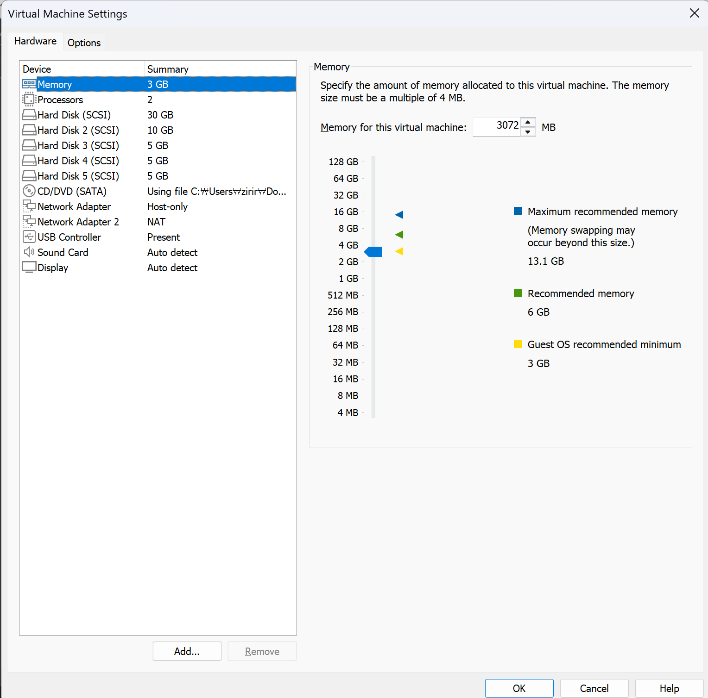

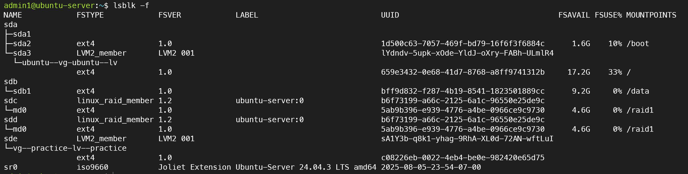

### 3.2 RAID1 장애 대응

**실습 목표:** RAID1 구성 디스크 중 하나에 장애가 발생해도 데이터를 계속 사용할 수 있는지 검증

**진행 과정**
1. `mdadm`을 이용한 RAID1 구성
2. `/proc/mdstat`으로 정상 상태 `[UU]` 확인
3. 구성 디스크 하나를 장애 상태로 변경
4. `[U_]` 상태에서 파일시스템 접근 가능 여부 확인
5. 장애 디스크 제거 및 재추가
6. 동기화 완료 후 `[UU]` 정상 상태 확인

**결과:** RAID1 디스크 한 개에 장애가 발생해도 데이터 접근이 유지되었으며, 디스크 재추가 후 정상 상태로 복구했습니다.

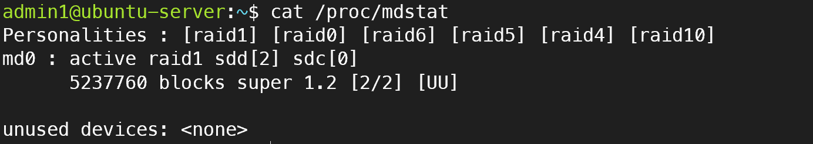

### 3.3 LVM 용량 부족 해결

**실습 목표:** 파일시스템 사용률 증가 상황에서 서비스 데이터를 유지하며 저장 공간 확장

**진행 과정**
1. `pvs`, `vgs`, `lvs`로 LVM 구성 확인
2. 테스트 데이터를 생성하여 디스크 사용률 약 94%까지 증가
3. `vg-practice`의 남은 공간 확인
4. `lvextend`로 논리 볼륨 약 900MB 확장
5. ext4 파일시스템 확장
6. `df -hT`로 사용률 약 77% 확인
7. 기존 테스트 파일 정상 접근 확인

**결과:** 데이터 삭제 없이 논리 볼륨과 파일시스템을 확장하여 디스크 사용률을 낮췄습니다.

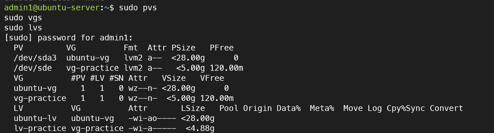

### 3.4 VMware 스냅샷 및 VM 복제

- VMware 스냅샷 생성 및 복원 테스트
- 원본 Ubuntu Server를 Full Clone 방식으로 복제
- 복제 VM의 hostname 및 machine-id 재설정
- 서버와 클라이언트의 네트워크 및 SSH 연결 확인

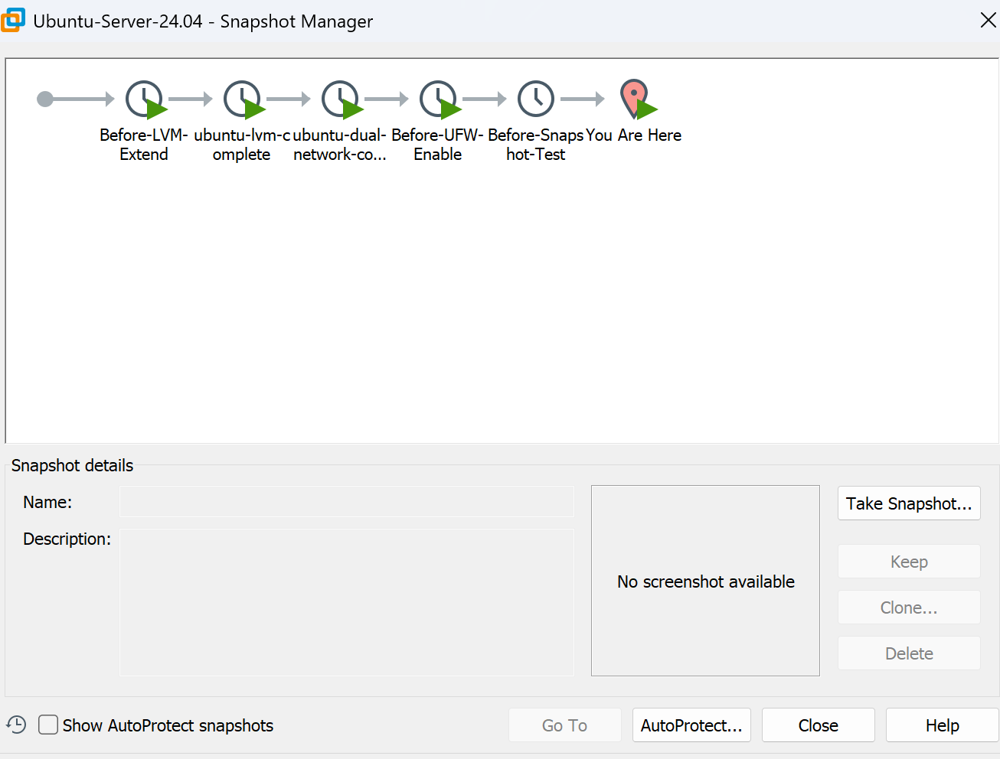

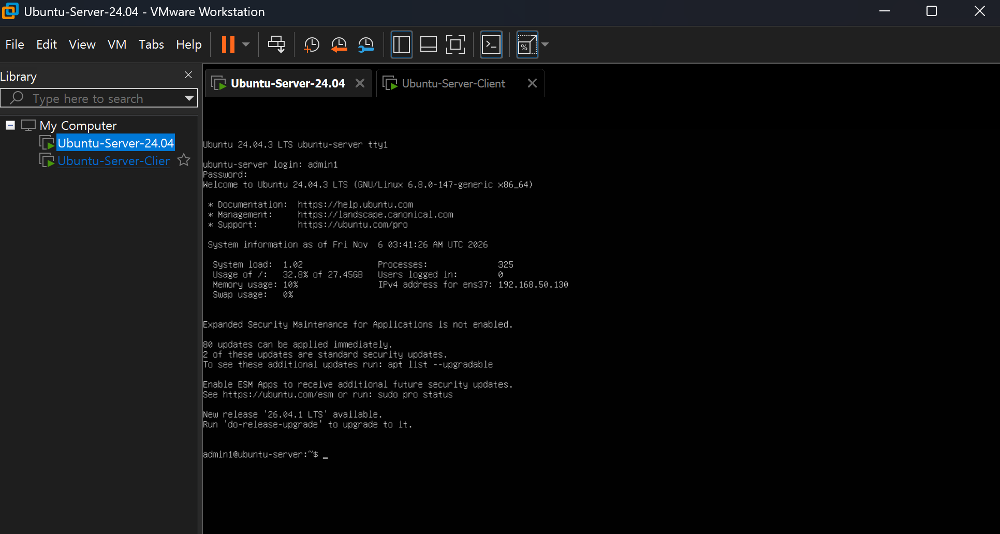

### 3.5 NFS 공유 스토리지

**실습 목표:** Linux 서버의 디렉터리를 네트워크로 공유하고 클라이언트에서 사용

- NFS 서버 공유 경로: `/srv/nfs/share`
- 클라이언트 마운트 경로: `/mnt/nfs`
- NFSv4.2 사용
- `exportfs -v`로 공유 설정 확인
- `findmnt`로 클라이언트 마운트 확인

**결과:** 서버와 클라이언트 간 NFS 공유 스토리지 연결을 확인했습니다.

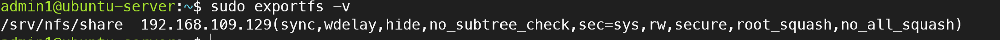

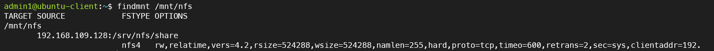

### 3.6 iSCSI 네트워크 스토리지

**실습 목표:** 서버의 저장소를 네트워크를 통해 클라이언트의 블록 디바이스로 제공

- `targetcli`를 이용한 3GB FileIO Backstore 생성
- iSCSI Target, LUN 및 ACL 구성
- TCP 3260 포트를 통한 클라이언트 접속
- 클라이언트에서 `/dev/sdf` 디스크 인식
- ext4 파일시스템 생성 및 `/mnt/iscsi` 마운트
- 테스트 파일 생성 및 읽기 검증

**결과:** 원격 스토리지를 클라이언트에서 로컬 디스크처럼 사용할 수 있음을 확인했습니다.

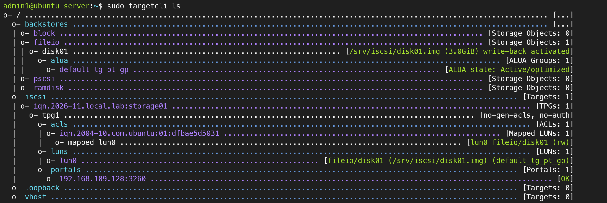

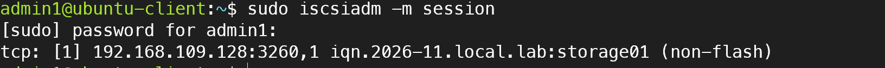

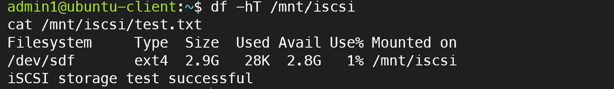

### 3.7 데이터 백업 및 복구

**실습 목표:** 파일 삭제 장애 발생 시 백업본을 이용하여 데이터 복구

**진행 과정**
1. `/data/project`에 테스트 파일 생성
2. `rsync -av`로 `/backup/project`에 백업
3. 원본 파일 삭제로 장애 상황 재현
4. 백업본의 데이터 존재 확인
5. `rsync`를 이용한 원본 경로 복구
6. `diff`로 원본과 백업 파일 내용 비교

**결과:** 삭제된 파일을 복원하고 데이터가 백업본과 일치함을 검증했습니다.

※ 이번 실습은 동일 VM 내부의 별도 경로에 백업한 것으로, 물리 디스크 전체 장애까지 보호하는 구성은 아닙니다.

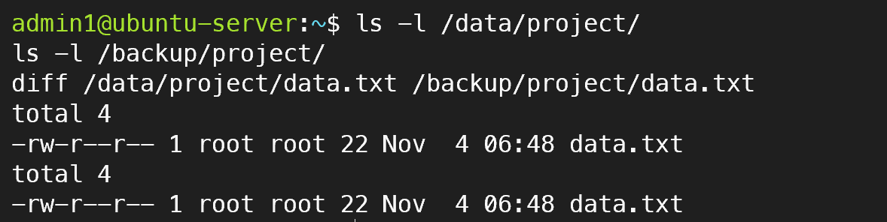

## 4. 장애 대응 경험 요약

| 장애 상황 | 확인 및 대응 | 결과 |
|---|---|---|
| RAID1 디스크 장애 | mdadm 상태 확인 및 디스크 재추가 | RAID1 정상 복구 |
| LVM 용량 부족 | VG 여유 공간 확인 및 LV/파일시스템 확장 | 사용률 94% → 77% |
| 파일시스템 마운트 해제 | fstab 설정 확인 및 재마운트 | 데이터 접근 복구 |
| 파일 삭제 | rsync 백업본으로 복원 | 데이터 일치 확인 |
| VM 복제 후 네트워크 문제 | machine-id 및 SSH 방화벽 설정 점검 | 클라이언트 SSH 접속 성공 |

## 5. 학습 성과

- Linux 블록 디바이스, 파티션, 파일시스템, 마운트 구조 이해
- RAID1의 장애 허용 및 복구 절차 실습
- LVM을 활용한 저장 공간 확장 경험
- NFS 파일 공유와 iSCSI 블록 스토리지의 차이 이해
- VMware 가상머신 복제 및 네트워크 구성 경험
- rsync를 활용한 데이터 백업과 복구 검증
- 장애 발생 시 상태 확인 → 원인 분석 → 조치 → 검증 순서의 문제 해결 경험

## 6. 향후 개선 계획

- 백업 저장소를 별도 디스크 또는 별도 서버로 분리
- 백업 자동화 및 복구 테스트
- 스토리지 사용률 모니터링과 경고 설정
- 장애 대응 절차를 운영 문서로 정리
